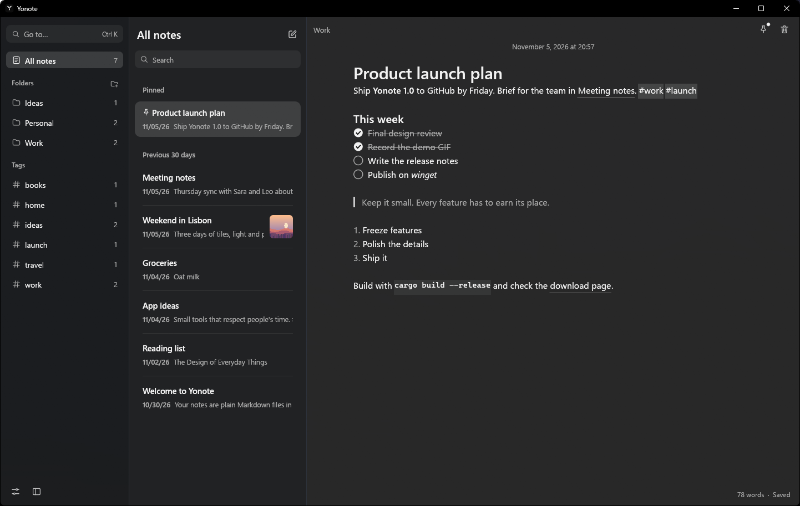
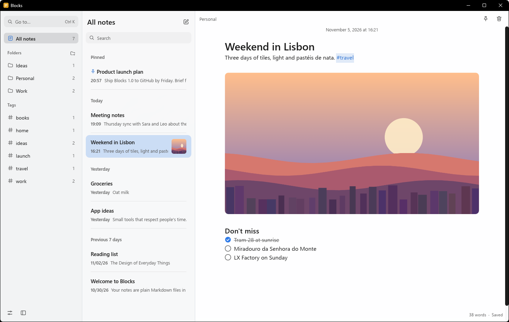
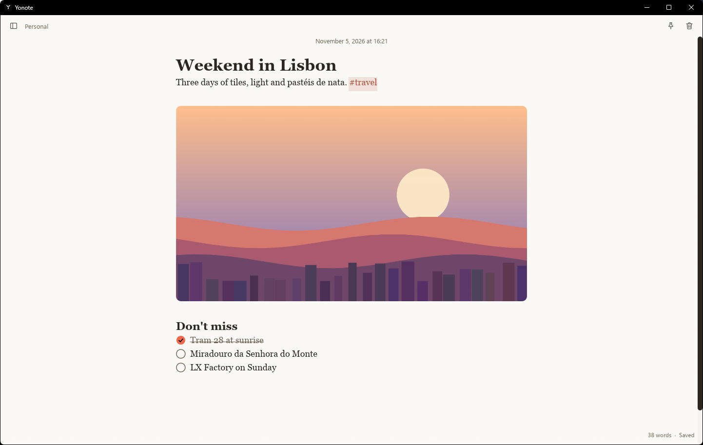
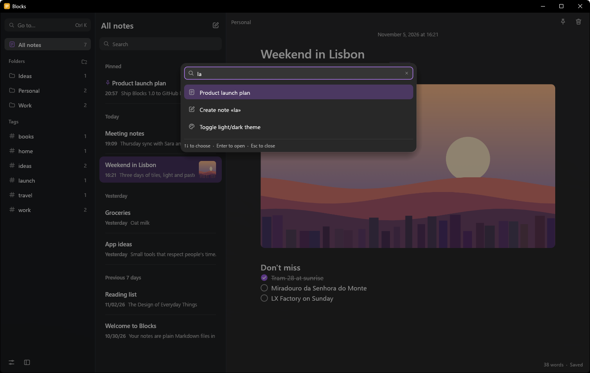
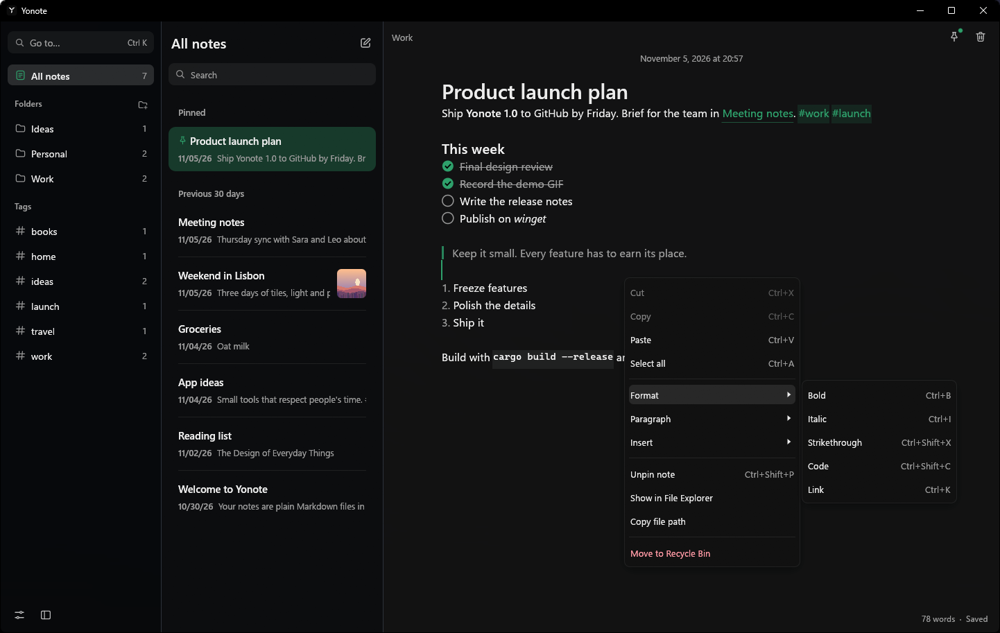
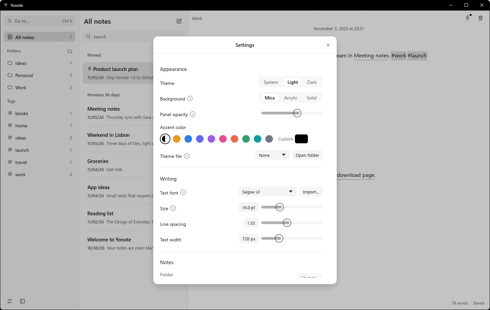

<p align="center">
  
</p>

<h1 align="center">Yonote</h1>

<p align="center">
  Light notes for Windows. Your notes are plain Markdown files in a folder you own.<br>
  One small app that opens instantly. No AI, no telemetry, no account.
</p>

<p align="center">
  <a href="../../releases/latest"></a>
  <a href="https://ko-fi.com/moosedevpjs"></a>
  
  
</p>

<p align="center">
  
</p>

---

## Why Yonote

- **Write, don't format.** You type Markdown and see it formatted as you go. The symbols only show on the line you are editing: the calm of Apple Notes with the freedom of Obsidian.
- **Your files, forever.** Every note is a `.md` file. Put the folder on OneDrive or Google Drive and it follows you. Open an existing Obsidian folder and it just works.
- **Instant.** Written in Rust. It opens in about 0.15 s and uses no CPU while you're not typing.
- **Safe by design.** Notes save automatically with atomic writes. Deleted notes go to the Windows Recycle Bin, with Undo. If another program edits the same note, Yonote keeps both versions instead of overwriting one.

## Features

| | |
|---|---|
| **Live preview** | Headings, **bold**, *italic*, lists, quotes, code, dividers |
| **Checklists** | Click to tick. `Ctrl+L` adds a checkbox, `Ctrl+Enter` ticks it |
| **Images** | Paste a screenshot with `Ctrl+V`, drag a file in, or right-click → Insert |
| **Links** | `[text](url)`, `[[Another note]]` with autocomplete, backlinks ("Linked from…") |
| **Organize** | Folders, `#tags`, pinned notes, multi-select with `Ctrl`/`Shift`+click, `Del` to delete |
| **Find anything** | Search all notes ignoring case and accents, find and replace inside a note, the `Ctrl+K` command palette |
| **Make it yours** | Mica, Acrylic or solid background, light/dark/system theme, black & white by default or any accent color, `.toml` theme files, your own fonts |
| **Native** | Right-click menus, "Open with" for `.md` files (edits the file in place), screen reader labels, English and Italian |
| **Updates** | Checks GitHub for new versions and updates itself in one click |

## Screenshots

| | |
|---|---|
|  |  |
| Light theme, black & white accent, an image in the note | "Carta" theme, coral accent, Georgia font, focus mode |
|  |  |
| `Ctrl+K` palette, dark theme | Right-click menu, "Notte" (OLED black) theme, green accent |
|  | |
| Settings | |

*The notes in the screenshots are made-up examples.*

## Install

### Recommended: the installer

1. Open the [latest release](../../releases/latest) and download **`Yonote-0.2.1-setup.exe`**.
2. Run it. No administrator rights are needed: Yonote installs for your user only.
3. Choose your options:
   - **Add Yonote to "Open with" for Markdown files.** Right-click any `.md` file → *Open with* → *Yonote*. The file is edited in place, never copied.
   - **Create a desktop shortcut** (optional).
4. Start Yonote and pick the folder for your notes, or use the suggested `Documents\Notes`.

To uninstall, open *Settings → Apps → Installed apps → Yonote*. Your notes are never touched.

### Updates

Yonote checks this repository for new releases when it starts (you can turn this off in Settings). When an update is available, a small **Update to x.y.z** button appears in the bottom-left corner: it shows what's new, downloads the installer, verifies its SHA-256 checksum and restarts Yonote on the new version. You can also check by hand in *Settings → Updates → Check now*.

> Coming from **Blocks** (the old name)? Install Yonote over it: your settings, themes, fonts and notes are moved over automatically.

> Windows SmartScreen may warn you because the installer isn't code-signed yet. Click **More info → Run anyway**.

### Build from source

Only if you want to work on the code. You need [Rust](https://rustup.rs) 1.88 or newer on Windows 10 or 11.

```bash
git clone https://github.com/MooseDevPJS/yonote.git
cd yonote
cargo build --release
```

The app is at `target\release\yonote.exe`. To build the installer as well, install [Inno Setup 6](https://jrsoftware.org/isinfo.php) and run:

```bash
"C:\Program Files (x86)\Inno Setup 6\ISCC.exe" installer\yonote.iss
```

The installer is written to `installer\Output\`.

## Keyboard shortcuts

| Shortcut | Action |
|---|---|
| `Ctrl+N` | New note |
| `Ctrl+K` / `Ctrl+P` | Go to a note or run a command |
| `Ctrl+Shift+F` | Search all notes |
| `Ctrl+F` / `Ctrl+H` | Find / replace in the note (`Enter`, `Shift+Enter` or `F3` to move between results) |
| `Ctrl+B` / `Ctrl+I` / `Ctrl+Shift+X` / `Ctrl+Shift+C` | Bold / italic / strikethrough / code |
| `Ctrl+K` with text selected | Make a link |
| `Ctrl+1` `2` `3` / `Ctrl+0` | Headings / normal text |
| `Ctrl+L` / `Ctrl+Enter` | Checklist / tick |
| `Tab` / `Shift+Tab` | Indent lists |
| `Ctrl+\` / `Ctrl+Shift+\` | Hide folders / focus mode |
| `Ctrl+Shift+P` | Pin the note |
| `Del` | Move the selected notes to the Recycle Bin |
| `Alt+←` / `Alt+→` | Previous / next note |
| `Ctrl+,` | Settings |
| `Ctrl+click` | Open links, notes and tags |

## Where your data lives

- **Notes:** the folder you choose. Pinned notes and the last open note are kept in `.yonote/state.toml` inside it.
- **Settings, themes, imported fonts and the log:** `%APPDATA%\Yonote\config\`. Set the `YONOTE_CONFIG_DIR` environment variable to keep them somewhere else, for example on a USB stick.

## Themes

Theme files are TOML files in `%APPDATA%\Yonote\config\themes\`. Only the colors you set are changed:

```toml
name = "Paper"
base = "light"

[colors]
sidebar = "#F1ECE1"
editor  = "#FCFAF5"
text    = "#2B2620"
accent  = "#C8102E"
```

Yonote reloads the theme while you edit the file.

## Project layout

```
src/
├── main.rs        startup, window, app icon
├── app/           app state (mod.rs), the three columns (panels.rs), dialogs (dialogs.rs)
├── editor.rs      live-preview editor, right-click menu, suggestions, images
├── find.rs        find and replace in the open note
├── markdown.rs    Markdown parsing for the preview, tags, links
├── vault.rs       notes folder: scan, load, save, rename, search
├── theme.rs       fonts, colors, accent, theme files
├── widgets.rs     UI components (rows, dialogs, buttons, Ko-fi card)
├── icons.rs       hand-drawn SVG icons
├── platform.rs    Windows: background effect, "Open with"
├── update.rs      updates from GitHub releases
└── settings.rs, i18n.rs, fsutil.rs
assets/            app icon, welcome notes
installer/         Inno Setup script
```

Run the tests with `cargo test`.

## Support

Yonote is free and will stay free. If it's useful to you, [buy me a coffee on Ko-fi](https://ko-fi.com/moosedevpjs). ☕

## Credits

Created by [MooseDevPJS](https://github.com/MooseDevPJS), with Claude (Anthropic) as collaborator.

## License

Yonote is released under the [PolyForm Noncommercial License 1.0.0](LICENSE).

- ✅ Free to use, study, change and share for **personal and other noncommercial** purposes.
- ✅ Charities, schools, public research and government organizations can use it too.
- ❌ **Commercial use is not allowed**: you can't sell Yonote or use it in a for-profit product or service.

The source code is public, but this is a *source-available* license, not an OSI "open source" one.
